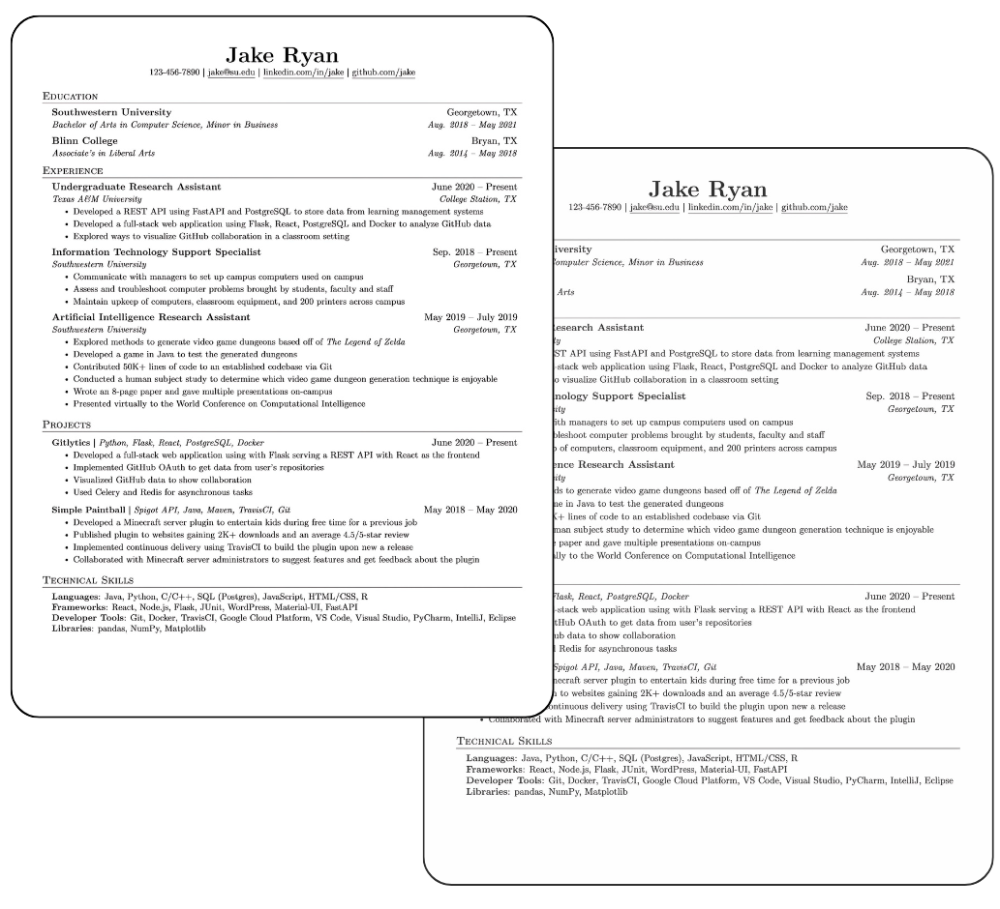

<div align="center">

# Rezume — AI-Powered Resume Builder

**Create, preview, download, and review your resume in one place.**

A React-based resume builder with structured editing, PDF export, and an AI-assisted resume rating workflow powered by Google Gemini.

<br />


</div>

---

## Table of Contents

- [Overview](#overview)
- [Features](#features)
- [Application Screens](#application-screens)
- [Technology Stack](#technology-stack)
- [How It Works](#how-it-works)
- [Getting Started](#getting-started)
- [Environment Configuration](#environment-configuration)
- [Available Scripts](#available-scripts)
- [Project Structure](#project-structure)
- [Implementation Notes](#implementation-notes)
- [Future Improvements](#future-improvements)
- [Author](#author)

---

## Overview

**Rezume** is a web application designed to make resume creation and basic resume evaluation easier. It provides a guided form-based editor where users can enter their professional information, organize it into resume sections, and generate a PDF document.

The application also includes a resume review workflow. A user can upload a PDF resume, the application extracts its text in the browser, and that text is sent to the Google Gemini API to receive a rating.

The project brings two workflows together:

1. **Build a resume:** Enter information through guided sections and preview or export the generated resume.
2. **Review a resume:** Upload an existing PDF and receive an AI-generated rating.

## Features

### Resume Builder

- **Guided resume editor** with separate sections for:
  - Personal information
  - Work experience
  - Projects
  - Technical and professional skills
  - Education
  - Leadership experience
  - Achievements
- **Section-based navigation** to move through the resume creation process.
- **Dynamic entries** for adding and removing education, experience, projects, and leadership details.
- **Browser storage** using `localStorage` to retain resume data between page visits in the same browser.
- **Resume preview** using `@react-pdf/renderer`.
- **PDF output** so users can download their completed resume.

### AI Resume Review

- Upload an existing resume in PDF format.
- Extract text from the uploaded PDF using `react-pdftotext`.
- Enforce a 10 MB upload-size limit in the upload flow.
- Send extracted resume text to Google's Gemini 2.0 Flash model.
- Display an AI-generated rating using the response categories requested by the application: Average, Good, Excellent, or Outstanding.

### User Interface

- Responsive React interface.
- Dedicated home, resume creation, PDF preview/download, and resume review routes.
- Icons and interface elements powered by Lucide React and Tailwind CSS.

## Application Screens

### Resume Builder


### Resume Template Preview



> These screenshots use image assets included in this repository. If you replace or move the assets, update the paths above.

## Technology Stack

| Technology | Purpose |
|---|---|
| React 18 | Component-based user interface |
| JavaScript | Application logic and interactions |
| Tailwind CSS | Utility-first styling and responsive layouts |
| React Router DOM | Client-side navigation |
| React Context API | Shared resume state across components |
| React Hooks | Component state and lifecycle management |
| `localStorage` | Persisting resume data in the browser |
| `@react-pdf/renderer` | Rendering and previewing resume PDFs |
| `react-pdftotext` | Extracting text from uploaded PDF resumes |
| Axios | Sending HTTP requests to the Gemini API |
| Google Gemini API | AI-assisted resume rating |
| Lucide React | Icons |

## How It Works

### 1. Create a Resume

1. Open the resume creation page.
2. Fill in the guided sections, including personal information, experience, projects, skills, education, leadership, and achievements.
3. Add or remove entries where required.
4. Move through the sections using the editor navigation.
5. Preview the generated resume and download it as a PDF.

### 2. Review an Existing Resume

1. Open the Resume Review page.
2. Upload a PDF resume (up to 10 MB).
3. The application extracts the text from the PDF in the browser.
4. Select **Start Now** to submit the extracted text to Gemini.
5. View the rating returned by the AI model.

## Getting Started

Follow these steps to run the application locally.

### Prerequisites

Make sure the following are installed:

- [Node.js](https://nodejs.org/) (LTS version recommended)
- npm (included with Node.js)
- A Google AI Studio API key for the Gemini-powered review feature

Check your installation:

```bash
node --version
npm --version
```

### 1. Clone the Repository

```bash
git clone <YOUR_GITHUB_REPOSITORY_URL>
cd <YOUR_PROJECT_DIRECTORY>
```

Replace the placeholders with the URL and directory name of your GitHub repository.

### 2. Install Dependencies

```bash
npm install
```

### 3. Configure the Environment Variable

Create a `.env` file in the project root and add your Gemini API key:

```env
REACT_APP_API_KEY=your_gemini_api_key
```

See [Environment Configuration](#environment-configuration) for important security notes.

### 4. Start the Development Server

```bash
npm start
```

The application will be available at:

```text
http://localhost:3000
```

## Environment Configuration

The resume review implementation reads the Gemini API key from:

```js
process.env.REACT_APP_API_KEY
```

For local development, define `REACT_APP_API_KEY` in the root `.env` file before starting the application. Restart the development server after changing environment variables.

**Security note:** This project currently calls the Gemini API directly from the React frontend. Environment variables prefixed with `REACT_APP_` are embedded into the client-side build and are not secret. Do not use a sensitive or unrestricted production API key in a public frontend. For production, route Gemini requests through a backend service or serverless function, keep the key on the server, and apply suitable usage limits and restrictions.

Also ensure `.env` is ignored by Git and never commit your API key. If a key has already been pushed to a public repository, revoke or rotate it in Google AI Studio.

## Available Scripts

Run these commands from the project root:

| Command | Description |
|---|---|
| `npm start` | Starts the development server |
| `npm test` | Runs the test suite in interactive watch mode |
| `npm run build` | Creates an optimized production build |
| `npm run eject` | Ejects Create React App configuration (one-way operation) |

## Project Structure

```text
.
├── public/
│   ├── assets/                 # Images, icons, illustrations, and animations
│   ├── fonts/                  # Font files used by the application
│   └── index.html
├── src/
│   ├── Resume/
│   │   ├── Reflect.jsx         # Resume PDF preview/download flow
│   │   └── Resume.jsx          # Resume PDF document layout
│   ├── components/
│   │   ├── home/               # Landing page sections
│   │   ├── review/             # PDF upload and AI review flow
│   │   ├── sections/           # Resume editor sections
│   │   ├── Editor.jsx          # Section-based editor
│   │   ├── NextBtn.jsx
│   │   └── SideNav.jsx
│   ├── contexts/
│   │   └── ResumeData.js       # Shared resume state and localStorage persistence
│   ├── App.js                  # Application routes
│   ├── App.css
│   ├── index.css
│   └── index.js                # React entry point and providers
├── .env                        # Local environment variables (create locally)
├── package.json
└── README.md
```

## Implementation Notes

- Resume data is managed through React Context and stored in the browser's `localStorage` under the key `resumeLocal`.
- The PDF document is rendered with `@react-pdf/renderer` and displayed through its PDF viewer on supported screen sizes.
- The review flow extracts PDF text before making the Gemini API request; the PDF itself is not uploaded to a custom application backend in the current implementation.
- The Gemini review prompt currently asks the model for a single rating from a fixed set of categories. It is an AI-generated assessment, not a validated hiring score or guarantee of resume quality.
- The application is a client-side React project. No dedicated application backend or database is included in the provided source tree.

## Future Improvements

Potential areas to extend the project:

- Move Gemini API calls to a secure backend or serverless function.
- Provide detailed, actionable feedback instead of only a one-word rating.
- Add multiple resume templates and customization options.
- Add stronger form validation and clearer error handling for invalid or unreadable PDFs.
- Add automated tests for resume editing, PDF generation, and review workflows.
- Add secure account-based storage and resume management if a backend is introduced.

## Author

**Shubham Kumar**  
Software Developer | React.js | Java | Python | Data Engineering

- GitHub: [@shubhamthakur9771](https://github.com/shubhamthakur9771)

---

<div align="center">

**Rezume — Build your resume. Present your story.**

</div>
